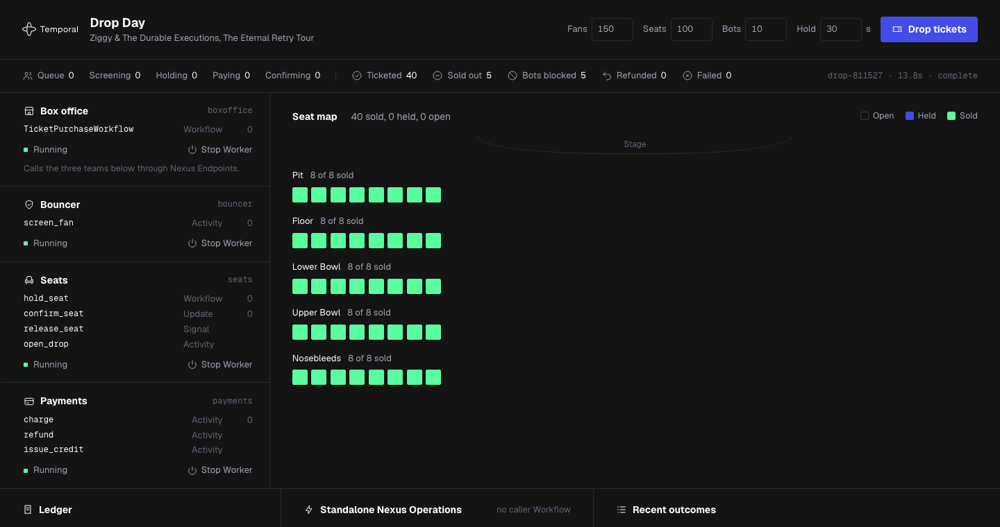
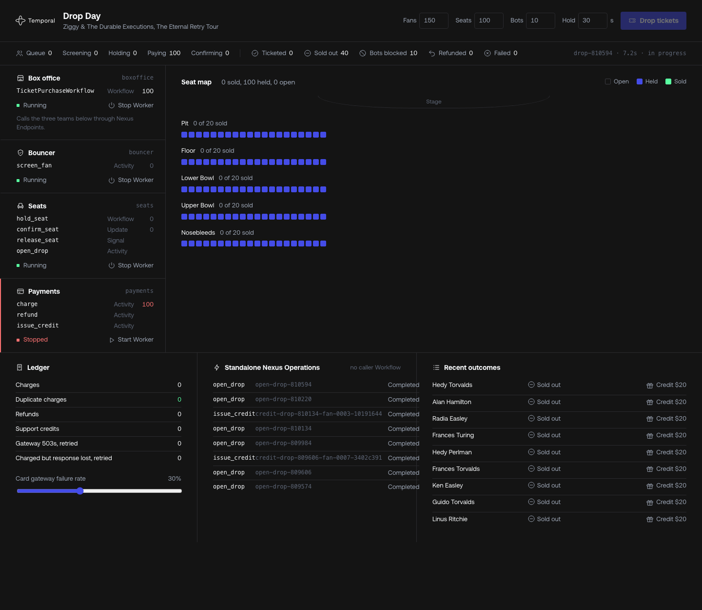

# Drop Day: a Nexus tutorial

Tickets for **Ziggy & The Durable Executions** go on sale at the same moment for everyone. Hundreds of fans and a few
scalper bots hit the box office at once, the card gateway falls over, Workers crash, and nobody gets charged twice.



Drop Day shows the main [Temporal Nexus](https://docs.temporal.io/nexus) choices in one app, each used where it fits:

| Choice | Used for | Why |
| --- | --- | --- |
| **Caller Workflow** | `TicketPurchaseWorkflow`, one per fan | Several Operations in a row, plus a refund saga |
| **Standalone Nexus Operation** | Venue manager's `open_drop`, support desk's `issue_credit` | One call from a script or UI backend, so no Workflow is needed |
| **Activity-backed Operation** ([Nexus Standalone Activity](https://docs.temporal.io/nexus/standalone-activity)) | `screen_fan`, `charge`, `refund`, `issue_credit`, `open_drop` | One durable step each, with no Workflow behind it |
| **Workflow-backed Operation** | `hold_seat`, `confirm_seat`, `release_seat` | A seat hold waits for a confirm or a timeout, so it needs a Workflow |

## Where the Temporal code is

All of it is in [`drop_day/temporal/`](drop_day/temporal). Start there if you're here to learn Nexus. The other two
folders exist so the app has something to talk to and something to watch.

```
drop_day/
  temporal/   The Temporal code: Nexus contracts, Workflows, Activities, Nexus handlers, Workers
  systems/    Pretend outside systems: a flaky card gateway and a seat database. No Temporal code.
  demo/       The dashboard, terminal board, and support script. Uses the Temporal Client to start
              drops, read progress, and run Standalone Nexus Operations.
```

| File in `drop_day/temporal/` | What it is |
| --- | --- |
| `contracts.py` | Nexus Service contracts. The only file the box office imports from other teams. |
| `boxoffice.py` | `TicketPurchaseWorkflow`, the caller, and the box office Worker |
| `bouncer.py` | Bot screening: an Activity-backed Operation |
| `seats.py` | Seats Nexus handlers, each Operation with a different backing |
| `seat_hold.py` | `SeatHoldWorkflow`: reserve, then confirm, release, or expire |
| `seat_inventory.py` | Seat Activities, each one call to the seat database |
| `payments.py` | Charge, refund, and credit Activities and their Nexus handlers |

The Standalone Nexus Operations are started from `demo/engine.py` (`open_drop`, `issue_credit`), because a Standalone
Nexus Operation is started by a Client, not by Workflow code.

## Architecture

Four teams, four Namespaces. The box office calls the other three through Nexus Endpoints.

```
                        ┌─ bouncer-endpoint ──▶  bouncer   screen_fan ─────────────▶ Activity
 boxoffice              │
 TicketPurchaseWorkflow ├─ seats-endpoint ────▶  seats     hold_seat ──────────────▶ SeatHoldWorkflow (Update-with-Start)
 (one per fan)          │                                  confirm_seat ───────────▶ Update on the hold
                        │                                  release_seat ───────────▶ Signal to the hold
                        │                                  open_drop ──────────────▶ Activity
                        └─ payments-endpoint ─▶  payments  charge / refund / issue_credit ─▶ Activity

 Venue manager, support desk ── Standalone Nexus Operations (no Workflow) ──▶ seats.open_drop, payments.issue_credit
```

Each fan's Workflow screens the fan, holds a seat, charges the card, and confirms the seat.

| What happens | What handles it |
| --- | --- |
| The gateway returns a 503 | The `charge` Activity's Retry Policy |
| The gateway charges the card and then drops the response | The Activity ID is the gateway's idempotency key. It's derived from the Nexus request ID and stays the same across retries, so the retry doesn't charge again. |
| The Payments Worker dies mid-charge | `charge` heartbeats, so the 3-second heartbeat timeout fires and the Activity retries once a Worker is back |
| A bot shows up | `screen_fan` raises a non-retryable `BotDetected` |
| Seats run out | `hold_seat` fails with `SoldOut` |
| A fan's Workflow stalls while holding a seat | `SeatHoldWorkflow`'s timer frees the seat on its own |
| The hold expires after the fan already paid | `confirm_seat` fails, so the box office refunds the charge (a saga) |

## Run it

Requires the [Temporal CLI](https://docs.temporal.io/cli/setup-cli) v1.9.1 or later and [uv](https://docs.astral.sh/uv/).

```bash
./start-server.sh                        # terminal 1: dev server, Web UI at http://localhost:8233
./setup.sh                               # terminal 2: Namespaces and Nexus Endpoints (run once per server start)
uv run python -m drop_day.demo.dashboard # terminal 2: dashboard + all four team Workers
```

Open http://localhost:8080 and press **Drop tickets**.

The dev server keeps everything in memory, so after restarting it, run `./setup.sh` again.

### Without the dashboard

Run each team's Worker in its own terminal, then use the terminal board:

```bash
uv run python -m drop_day.temporal.bouncer
uv run python -m drop_day.temporal.seats
uv run python -m drop_day.temporal.payments
uv run python -m drop_day.temporal.boxoffice
uv run python -m drop_day.demo.drop --fans 200 --seats 150 --bots 15 --gateway-flakiness 0.3 --hold-seconds 120
```

Support desk actions are Standalone Nexus Operations straight from a script:

```bash
uv run python -m drop_day.demo.support credit --drop drop-123456 --fan fan-0007 --amount 20 --reason "queue melted"
uv run python -m drop_day.demo.support list
temporal nexus operation list --namespace boxoffice
```

## The demo

1. Press **Drop tickets**. The bar under the header counts fans at each step, the team rail shows how many of each
   Nexus Operation are in flight, and seats on the map turn from open to held to sold.
2. While fans are paying, press **Stop Worker** under Payments. That sends SIGKILL to the Worker process. Payments is
   marked Stopped, its `charge` count stops moving, and every seat on the map stays held.

   

3. Press **Start Worker**. The heartbeat timeouts fire, the charges retry on the new Worker, and the seats turn sold.
   The ledger still shows **0 duplicate charges**.
4. Set **Hold** to 10 seconds and do it again, but leave Payments stopped for 15 seconds. Watch the held seats turn
   back to open: each `SeatHoldWorkflow` frees its seat on its own. When Payments comes back, those fans are charged,
   `confirm_seat` fails, and they're refunded.
5. Click **Credit $20** on a fan under Recent outcomes. That's a Standalone Nexus Operation from the dashboard's
   backend, with no Workflow. It appears under Standalone Nexus Operations.
6. In the Temporal Web UI, switch Namespaces. `bouncer` and `payments` show only Activities. `seats` shows
   `SeatHoldWorkflow` runs plus Activities. `boxoffice` shows one `TicketPurchaseWorkflow` per fan.

## Other files

| File | What it is |
| --- | --- |
| `drop_day/systems/card_gateway.py` | Pretend card gateway. Fails on purpose and honors idempotency keys, like real ones. |
| `drop_day/systems/seat_db.py` | Pretend seat database |
| `drop_day/systems/store.py` | SQLite helpers. Each team's data lives under `data/`; delete that folder to reset. |
| `drop_day/demo/engine.py` | Starts a drop and tracks every fan. Shared by the dashboard and the terminal board. |
| `drop_day/demo/dashboard.py`, `drop_day/demo/static/` | The live dashboard and its Worker controls |
| `drop_day/demo/drop.py`, `drop_day/demo/support.py` | Terminal board and support desk script |

The dashboard uses the Geist and Geist Mono fonts (SIL Open Font License, see `drop_day/demo/static/fonts/Geist-OFL.txt`) and the Temporal logo.
